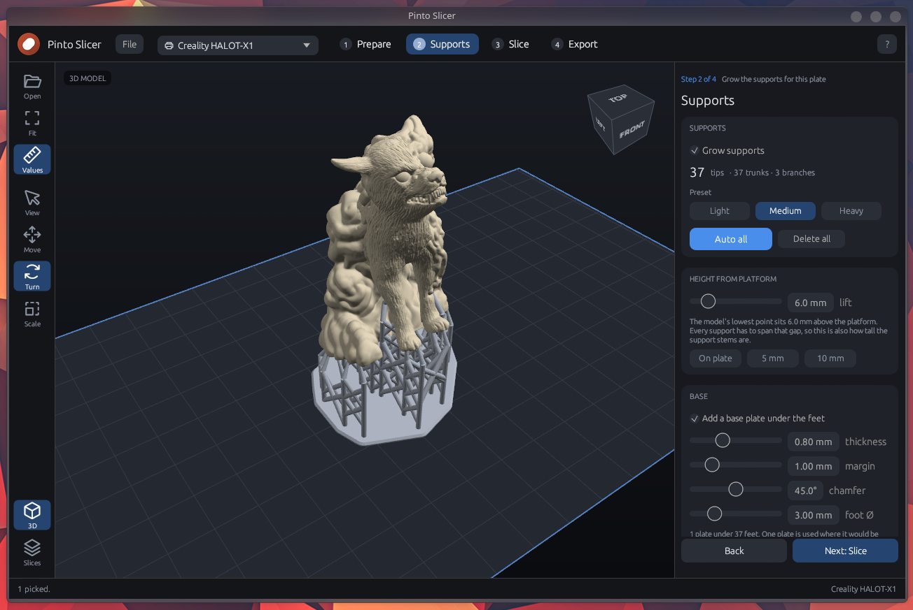

# Pinto Slicer

A Linux-first resin 3D printer slicer built with **Rust**, **egui**, and **wgpu**. Prepare STL/OBJ models, generate supports, inspect sliced layers, and export native printer jobs from a desktop app or the command line.



> [!WARNING]
> **Pinto Slicer is experimental.** Printer files have software-level validation, but physical-printer interoperability has not been verified. Run a small test print and confirm exposure, lift, retract, and settle settings for your printer and resin before starting a long job.

## Features

- **Interactive 3D preparation:** move, rotate, scale, mirror, duplicate, align, distribute, and automatically arrange models on the build plate.
- **Configurable automatic supports:** Light/Medium/Heavy presets, adjustable tips, branches, trunks, pads, and clear stale-support indicators after model edits.
- **Layer preview and playback:** inspect black-and-white exposure masks and step or play through the sliced job.
- **Self-contained projects:** save meshes, transforms, printer settings, supports settings, selection, and export options in a versioned `.rslice` file.
- **Native printer output:** ten built-in GUI profiles, twelve job formats, and export at each profile's exact native LCD resolution.
- **Safe background export:** cancellation, staged output, and atomic replacement help preserve a previous valid job if an export fails.
- **Command-line tools:** inspect models, export without opening a window, and capture application screenshots.
- **Global undo/redo:** coalesced project snapshots make model and layout edits easy to reverse.

## Download

Tagged [GitHub Releases](https://github.com/makzumi/pinto-slicer/releases) provide **Linux x86_64** AppImage and Flatpak packages. Both require a working Vulkan driver. See the [changelog](CHANGELOG.md) for release notes.

### AppImage

Download the AppImage and its `SHA256SUMS` file, verify the checksum, then make it executable:

```bash
sha256sum --ignore-missing -c SHA256SUMS
chmod +x Pinto-Slicer-*-x86_64.AppImage
./Pinto-Slicer-*-x86_64.AppImage
```

The AppImage is built on Ubuntu 22.04. On systems without FUSE, run it with `--appimage-extract-and-run`. Desktop AppImage integration tools can add it to your application menu.

### Flatpak

With the Flathub remote available for the Freedesktop runtime, install the downloaded bundle and run the app:

```bash
flatpak remote-add --user --if-not-exists flathub https://dl.flathub.org/repo/flathub.flatpakrepo
flatpak install --user ./Pinto-Slicer-*-x86_64.flatpak
flatpak run io.github.makzumi.pinto-slicer
```

The Flatpak targets Freedesktop 26.08. Missing runtime packages are downloaded from Flathub during installation.

## Quick start

### Prerequisites

- A recent [Rust toolchain with Cargo](https://rustup.rs/)
- A Linux desktop with a working Vulkan graphics driver for the GUI

### Run from source

```bash
git clone https://github.com/makzumi/pinto-slicer.git
cd pinto-slicer
cargo run --release -- --demo
```

The `--demo` flag loads two sample pieces. To start with an empty plate or open your own model:

```bash
cargo run --release
cargo run --release -- path/to/model.stl
```

### Install for the current Linux user

```bash
sh packaging/install-user.sh
```

The installer builds the release binary and installs:

- `~/.local/bin/pinto_slicer`
- A desktop application launcher
- The Pinto Slicer icon

No root access is required. Make sure `~/.local/bin` is on your `PATH` if you want to run `pinto_slicer` from a terminal.

## The four-step workflow

1. **Prepare** — Open one or more STL/OBJ files, choose a printer profile, and arrange the plate. Use the 3D handles or the **Transform** panel for precise placement. **Drop onto the plate** settles selected models, while **Align & space selected…** aligns or distributes multiple pieces.
2. **Supports** — Choose a preset and configure the platform gap, tips, branches, trunks, and base. Click **Auto all** to generate supports for the current plate. Model edits mark the support run as out of date instead of silently rebuilding it.
3. **Slice** — Set layer height and exposure, then click **Slice now**. Inspect the exposure mask, drag the layer slider, or use playback to move through the job.
4. **Export** — Choose a compatible format and destination. Export writes the printer job plus `job.json` and `README.txt`; optional PNG masks can also be written for each layer.

### Projects

Use the **File** menu to save and reopen `.rslice` projects. Meshes are embedded, so a project does not depend on the original STL/OBJ paths. Derived supports are not silently regenerated after opening; use **Auto all** on the Supports step when you are ready to rebuild them.

## Controls

| Action | Input |
| --- | --- |
| Orbit the view | Right-drag |
| Pan the view | Middle-drag |
| Zoom | Mouse wheel |
| Select a model | Left-click |
| Add to the selection | Shift-click |
| Box-select models | Left-drag on empty space |
| Fit the view | `F` |
| View / Move / Turn / Size tool | `W` / `G` / `R` / `S` |
| Toggle the Transform panel | `V` |
| Open models / Open project | `Ctrl+O` / `Ctrl+Shift+O` |
| Save project / Save project as | `Ctrl+S` / `Ctrl+Shift+S` |
| Undo / Redo | `Ctrl+Z` / `Ctrl+Shift+Z` or `Ctrl+Y` |
| Duplicate selection | `Ctrl+D` |
| Select all | `Ctrl+A` |
| Delete selection | `Delete` or `Backspace` |
| Cancel or clear the current interaction | `Esc` |

The navigation cube snaps the camera to six standard views. The Transform panel also provides numeric transforms, angle snapping, duplication, deletion, and axis mirroring.

## Command-line usage

The examples below use the installed `pinto_slicer` binary. When running from a source checkout, replace `pinto_slicer` with `cargo run --release --`.

### Open the GUI

```bash
pinto_slicer                           # Empty plate
pinto_slicer --demo                    # Sample scene
pinto_slicer part.stl                  # One model
pinto_slicer a.stl b.obj               # Multiple models
pinto_slicer ~/parts/                  # Every STL/OBJ in a folder
pinto_slicer project.rslice            # Reopen a saved project
pinto_slicer --demo --preview          # Start on the Slice step
pinto_slicer --tab supports part.stl   # Start on a specific step
pinto_slicer --tool turn part.stl      # Start with a specific tool
```

`--tab` accepts `prepare`, `supports`, `slice`, or `export`. `--tool` accepts `view`, `move`, `turn`, or `size`.

### Inspect and export without opening a window

```bash
pinto_slicer --inspect ~/parts/
pinto_slicer --export job.cxdlpv4 part.stl
pinto_slicer --export job.cxdlpv4 part.stl --no-masks
pinto_slicer --printer 'ELEGOO Saturn 3 Ultra' --export job.ctb part.stl
pinto_slicer --export job.sl1s part.stl
```

The output extension selects the job format. `--printer` selects a hardware profile; otherwise the profile is inferred from the format where possible. Batch export always uses the profile's full native LCD resolution. `--no-masks` disables the optional PNG layer sidecars.

### Capture a screenshot

```bash
pinto_slicer --demo --screenshot docs/pinto-slicer-preview.png
```

Screenshot mode waits for the scene and support run to finish, draws the window, saves a PNG, and exits without taking focus.

## Printer profiles and formats

| Profile | Native LCD | Default output |
| --- | ---: | --- |
| Creality HALOT-X1 | 15120 × 6230 | `.cxdlpv4` |
| Creality HALOT-ONE | 1620 × 2560 | `.cxdlp` |
| ELEGOO Saturn 3 Ultra | 11520 × 5120 | `.ctb` |
| ELEGOO Saturn 4 Ultra 12K | 11520 × 5120 | `.goo` |
| Anycubic Photon | 1440 × 2560 | `.photon` (`.pws` alternative) |
| Anycubic Photon Mono | 1620 × 2560 | `.pwmo` |
| Anycubic Photon Mono X | 3840 × 2400 | `.pwmx` |
| Anycubic Photon M3 | 4096 × 2560 | `.pm3` |
| Original Prusa SL1 | 1440 × 2560 | `.sl1` |
| Original Prusa SL1S SPEED | 1620 × 2560 | `.sl1s` |

Batch export additionally supports **Anycubic Photon Mono 4K** for `.pwma` jobs. Alternative formats are constrained by the selected printer profile rather than being treated as interchangeable extensions.

The writers cover `.ctb`, `.goo`, `.cxdlp`, `.cxdlpv4`, `.photon`, `.pwmo`, `.pwmx`, `.pm3`, `.pws`, `.pwma`, `.sl1`, and `.sl1s`.

## Verification status

The test suite covers model loading, slicing, layout, project round-trips, support generation, export replacement, printer-format structures, codecs, checksums, and available readback paths. Sample outputs have also been independently opened and extracted with UVtools.

These checks provide useful software validation, but they do **not** establish physical-printer acceptance. Machine-specific motion defaults are intentionally conservative and should be tuned for the target printer and resin.

## Development

See [RELEASING.md](RELEASING.md) for AppImage/Flatpak build instructions and the tagged GitHub release process.

Run the standard checks before submitting changes:

```bash
cargo test
cargo clippy --all-targets -- -D warnings
```

Headless Vulkan tests return early when no compatible adapter is available. Additional high-resolution, heavy-plate, and large-project checks are marked ignored because they are substantially more expensive.

To regenerate a demo screenshot from a source checkout:

```bash
cargo run --release -- --demo --screenshot docs/pinto-slicer-preview.png
```

## Implementation and acknowledgments

- The desktop interface uses [egui/eframe](https://github.com/emilk/egui), with a wgpu viewport and cached mesh buffers.
- The support generator is ported and adapted from [PrusaSlicer's MSLA pipeline](https://github.com/prusa3d/PrusaSlicer), including support-point propagation, pinheads, pillars, routing, bridges, and contour-derived pads. Raster island sampling uses deterministic farthest-point placement.
- Printer-format implementations were cross-checked against [UVtools](https://github.com/sn4k3/UVtools) and its machine registry. CTB/GOO encoding uses the [`msla_format`](https://crates.io/crates/msla_format) crate.

See [NOTICE](NOTICE) for third-party attribution.

## License

Pinto Slicer is licensed under the **GNU Affero General Public License v3.0 only** (`AGPL-3.0-only`). See [LICENSE](LICENSE) for the full license text.

This preserves the licensing requirements of the PrusaSlicer-derived support-generation code. Upstream projects and third-party dependencies retain their respective copyrights and notices.
